<div align="center">

# PLAY WTW

**Play with me and talk with me**

مكان تجتمع فيه مع ربعك: قروبات، رومات كتابية وصوتية، وبث شاشة لين 4K. بدون تحميل برامج، يشتغل من المتصفح.

🔗 **[افتح الموقع](https://play-wtw.tk2jwv7v5t.workers.dev)**

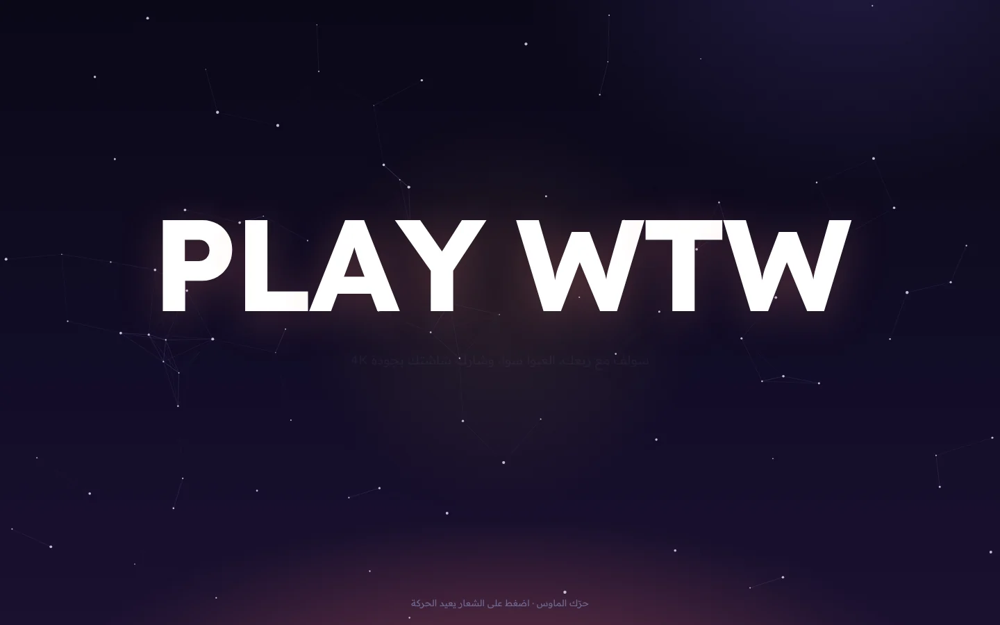

</div>

## وش تقدر تسوي فيه

| | |
|---|---|
| **قروبات ورومات** | سوّ قروب لك ولأصحابك، وفيه رومات كتابية وصوتية. تدعوهم برابط واحد. |
| **شات** | الرسايل تنحفظ، تشوف مين يكتب، وتوصلك إشعارات لو كنت في تاب ثاني. |
| **مكالمات صوتية** | تشوف مين في كل روم ومين يتكلم. عزل ضوضاء بالذكاء الاصطناعي يشيل صوت الكيبورد والمكيف. |
| **بث الشاشة** | لين 4K و144 فريم، وأكثر من شخص يقدر يبث بنفس الوقت. |
| **كل واحد على كيفه** | تختار جودة البث عندك، وتعلّي أو توطّي صوت أي شخص، أو تكتمه عندك بس. |
| **الجوال** | تتفرج وتسولف من الجوال، وتكبّر البث بإصبعين أو تفتحه ملء الشاشة. |

## صور من الموقع

### الشات
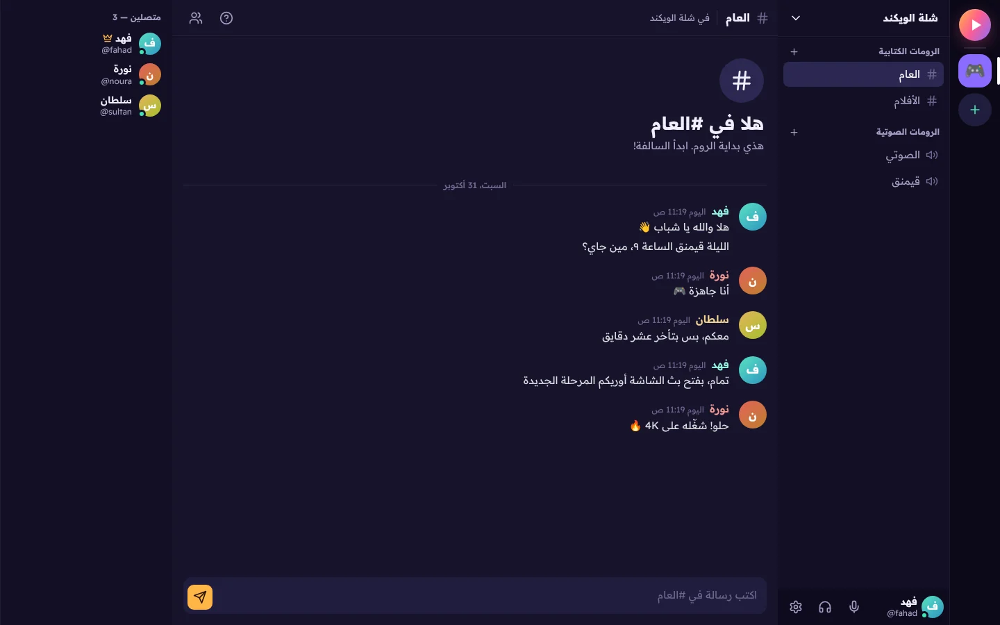

### روم صوتي وبث شاشة
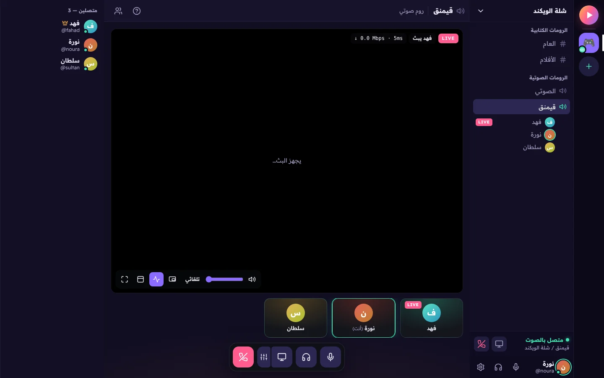

<table>
<tr>
<td width="50%"><b>جودة البث لكل مشاهد</b><br>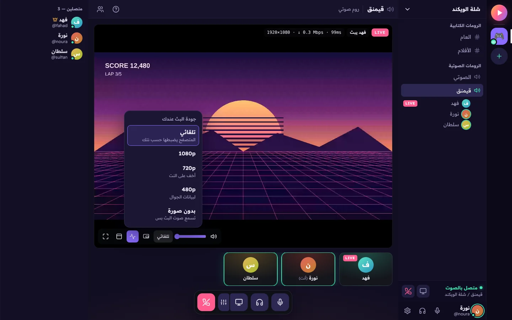</td>
<td width="50%"><b>صوت كل شخص لحاله</b><br>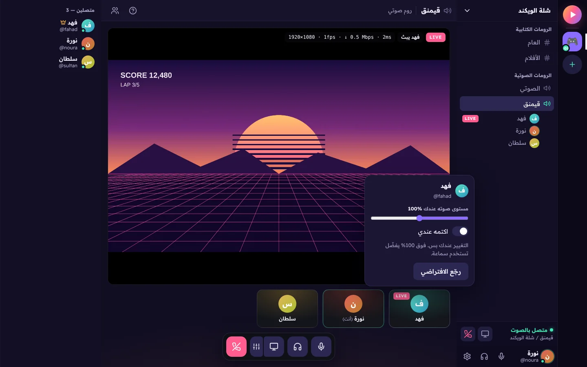</td>
</tr>
<tr>
<td><b>الإعدادات</b><br>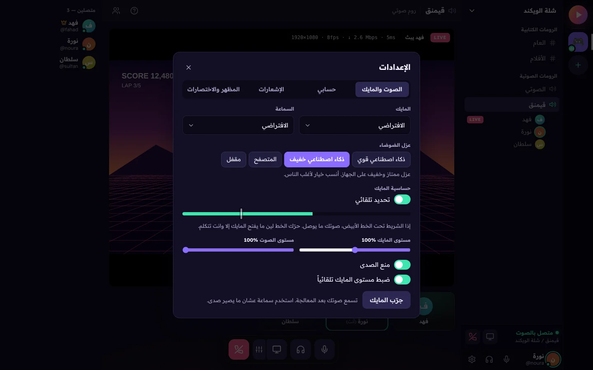</td>
<td><b>الدعم الفني</b><br>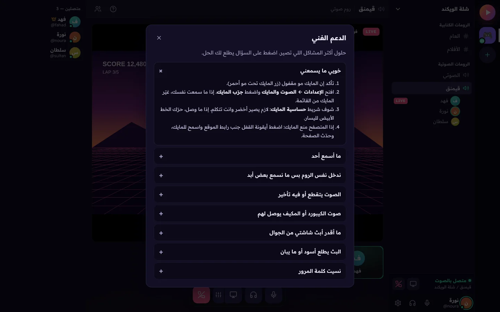</td>
</tr>
</table>

### تسجيل الدخول
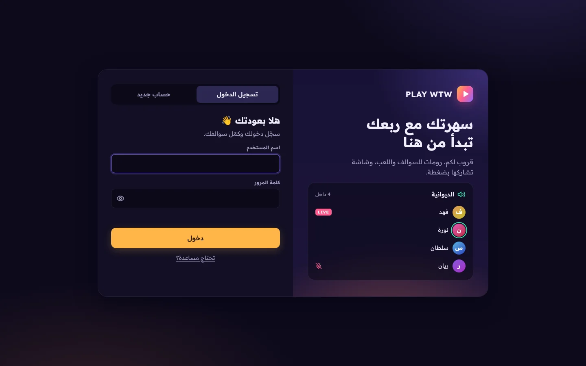

### الجوال
<p>
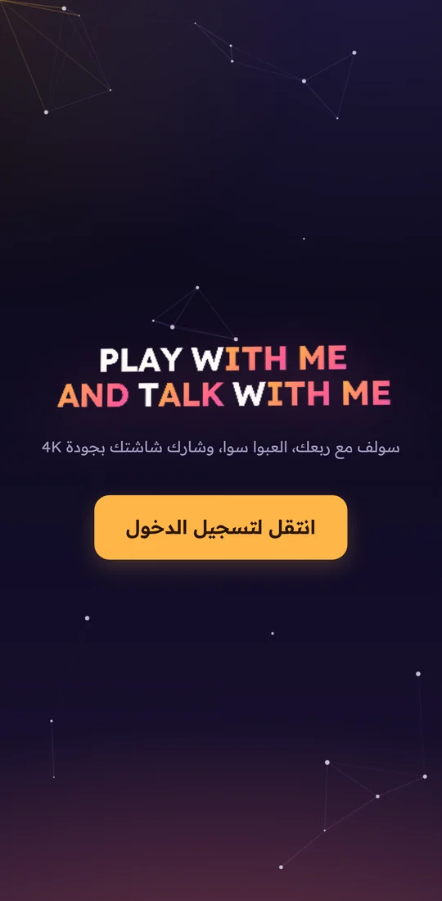
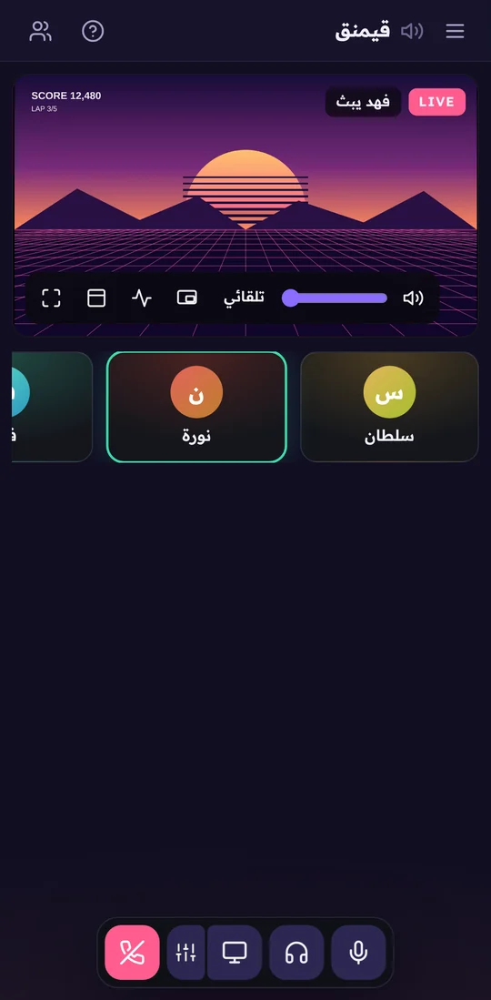
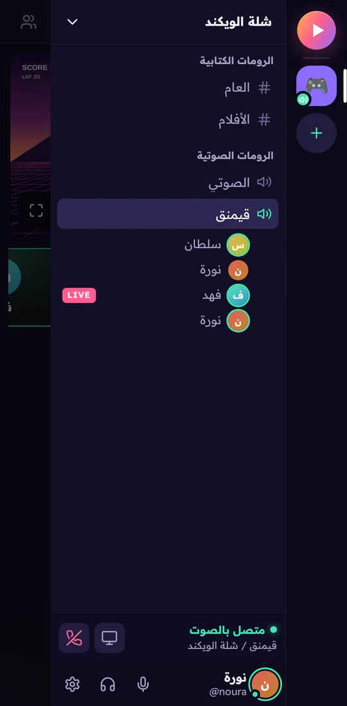
</p>

## المميزات بالتفصيل

**الحساب والإعدادات**
- تسجيل باسم مستخدم وكلمة مرور (مشفّرة بـ PBKDF2)، وتبقى مسجّل 30 يوم
- تغيير كلمة المرور (يطلّعك من باقي الأجهزة)، وحذف الحساب نهائياً
- الاسم ولون الصورة، وحجم الخط، وتقليل الحركة
- إشعارات الرسايل على الجهاز، وأصوات التنبيه

**الصوت**
- عزل ضوضاء بالذكاء الاصطناعي: قوي (GTCRN) أو خفيف (RNNoise)
- حساسية مايك تلقائية أو يدوية مثل الديسكورد، وزر "اضغط عشان تتكلم"
- اختيار المايك والسماعة، وزر تجربة المايك
- اختصارات: <kbd>M</kbd> المايك، <kbd>D</kbd> كتم الصوت

**البث**
- الدقة من 720p لين 4K، والفريمات من 15 لين 144، مع صوت الجهاز
- إعدادات جاهزة (موفّر، FHD، 2K، 4K، قيمرز)، وتغيير الجودة وانت تبث
- إحصائيات حقيقية للبث (الدقة، الفريمات، السرعة، البنق)
- ملء الشاشة، وتكبير بإصبعين أو بعجلة الماوس، وصورة داخل صورة

**الدعم الفني**
- مركز مساعدة فيه حلول أكثر المشاكل (المايك، الصوت، البث، الجوال)

## كيف يشتغل

```
المتصفح  ⇄  Cloudflare Worker  ⇄  Durable Object (SQLite)
   │          الحسابات والقروبات والرسايل والإشارات
   │
   └──── الصوت والبث مباشر بين الأجهزة (WebRTC) ────┘
         وإذا الشبكة تمنع الاتصال المباشر: عن طريق TURN
```

- **السيرفر:** Cloudflare Worker، والبيانات محفوظة في Durable Object (قاعدة SQLite مدمجة).
- **الصوت والبث:** يروحون مباشرة بين الأجهزة. كل مشاهد ياخذ نسخة لحاله، فسرعة الرفع اللي يحتاجها اللي يبث = البت ريت × عدد المشاهدين.

## الملفات

| المسار | وش فيه |
|---|---|
| `public/index.html` | الصفحة |
| `public/style.css` | التصميم |
| `public/js/main.js` | الواجهة: الحساب، القروبات، الشات، الإعدادات |
| `public/js/voice.js` | الاتصال بين الأجهزة وبث الشاشة |
| `public/js/audio.js` | معالجة المايك وعزل الضوضاء |
| `public/js/intro.js` | الشاشة الافتتاحية |
| `public/js/config.js` | بيانات التواصل في الدعم الفني |
| `public/vendor/nsp/` | مكتبة عزل الضوضاء ([web-noise-suppressor](https://github.com/sapphi-red/web-noise-suppressor)، رخصة MIT) |
| `worker/index.js` | السيرفر |
| `wrangler.jsonc` | إعدادات Cloudflare |
| `docs/screenshots/` | صور هالصفحة |

## التشغيل

الموقع مربوط بـ Cloudflare. كل تعديل ينرفع على `main` ينشر لحاله.

للتجربة على جهازك:
```sh
npx wrangler dev
```

### إعدادات اختيارية
- **سيرفر TURN:** عشان الشبكات اللي ما تتصل ببعض مباشرة (مثل بيانات الجوال). سوّ مفتاح من لوحة Cloudflare (Realtime ← TURN Server)، وحط قيمتين كـ Secrets في إعدادات الـ Worker: `TURN_KEY_ID` و `TURN_KEY_API_TOKEN`. بدونها الموقع يشتغل عادي بس بدون TURN.
- **التواصل في الدعم الفني:** حط الإيميل أو الروابط في `public/js/config.js`. إذا فاضية، قسم التواصل ما يطلع.

## ملاحظات
- بث الشاشة **من** الجوال ما يمدي، لأن متصفحات الجوال ما تسمح. تقدر تتفرج وتسولف من الجوال عادي.
- الدقة ما تطلع أعلى من دقة شاشة اللي يبث.
