<div align="center">

# PLAY WTW

**Play with me and talk with me**

مكان تجتمع فيه مع ربعك: قروبات، رومات كتابية وصوتية، وبث شاشة لين 4K. بدون تحميل برامج، يشتغل من المتصفح.

🔗 **[افتح الموقع](https://play-wtw.tk2jwv7v5t.workers.dev)**

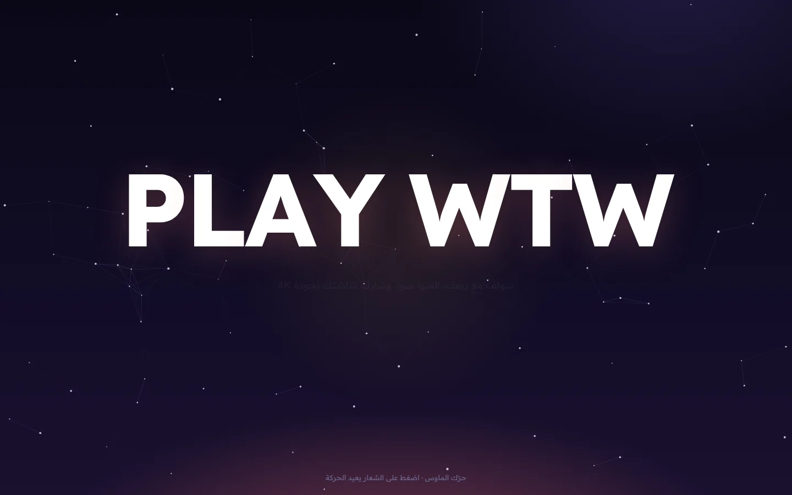

</div>

## وش تقدر تسوي فيه

| | |
|---|---|
| **قروبات ورومات** | سوّ قروب لك ولأصحابك، وفيه رومات كتابية وصوتية. تدعوهم برابط واحد. |
| **شات** | الرسايل تنحفظ، تشوف مين يكتب، وتوصلك إشعارات لو كنت في تاب ثاني. |
| **مكالمات صوتية** | تشوف مين في كل روم ومين يتكلم. عزل ضوضاء بالذكاء الاصطناعي يشيل صوت الكيبورد والمكيف. |
| **بث الشاشة** | لين 4K و144 فريم، وأكثر من شخص يقدر يبث بنفس الوقت. |
| **كل واحد على كيفه** | تختار جودة البث عندك، وتعلّي أو توطّي صوت أي شخص، أو تكتمه عندك بس. |
| **الجوال** | تتفرج وتسولف وتبث كاميرتك من الجوال، وتكبّر البث بإصبعين أو تفتحه ملء الشاشة. |

## صور من الموقع

### الرئيسية
لمحة عن كل شي: مين في روم صوتي الحين، قروباتك، مين متصل، آخر المحادثات، واللي يحتاج انتباهك.
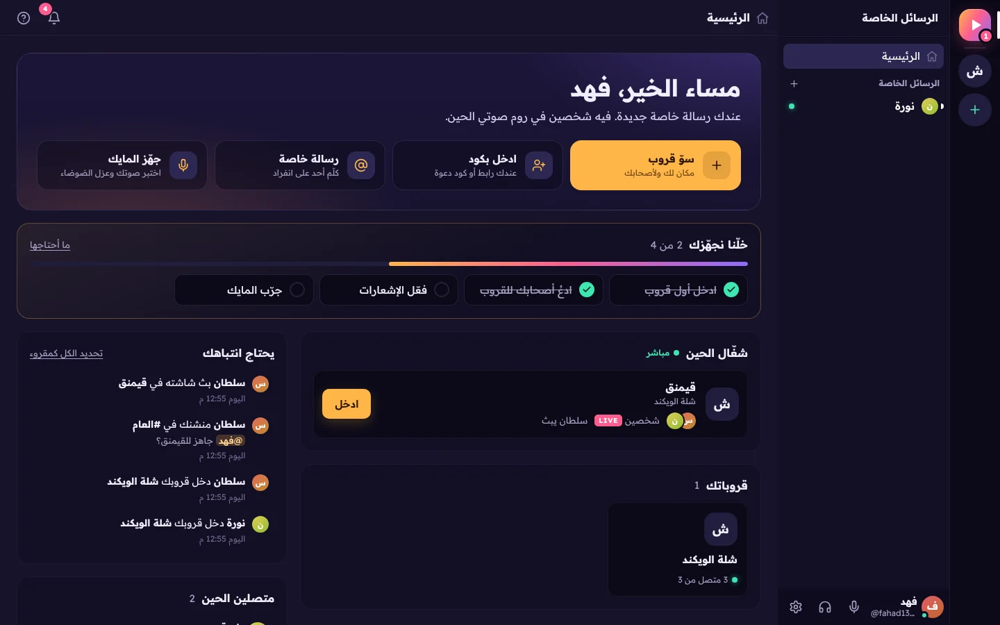

### الشات
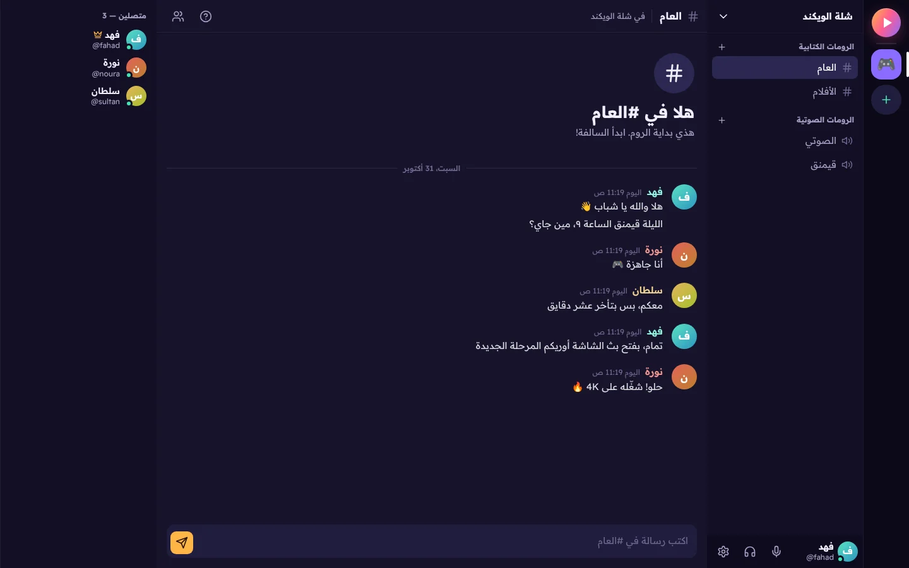

### روم صوتي وبث شاشة
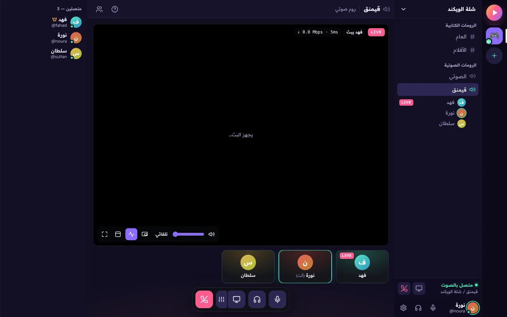

<table>
<tr>
<td width="50%"><b>جودة البث لكل مشاهد</b><br>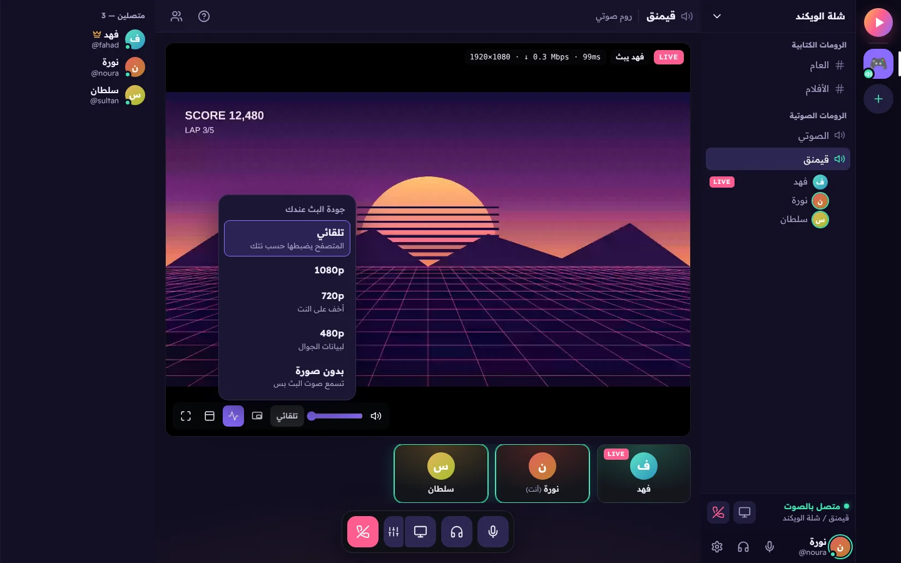</td>
<td width="50%"><b>صوت كل شخص لحاله</b><br>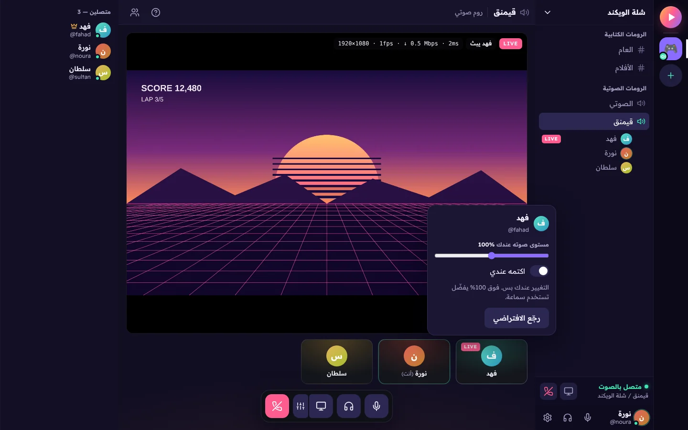</td>
</tr>
<tr>
<td><b>الإعدادات</b><br>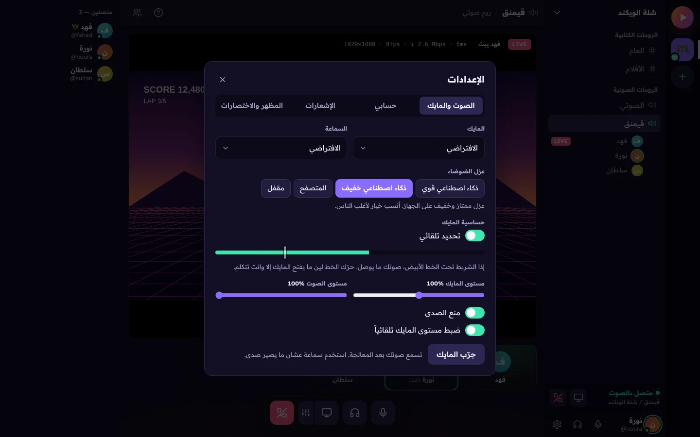</td>
<td><b>الدعم الفني</b><br>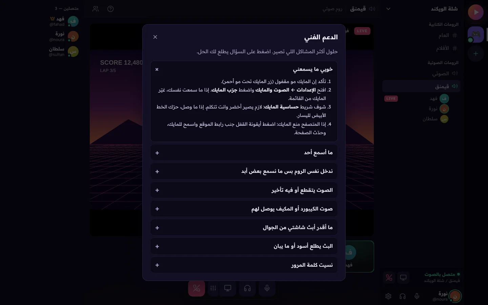</td>
</tr>
</table>

### تسجيل الدخول
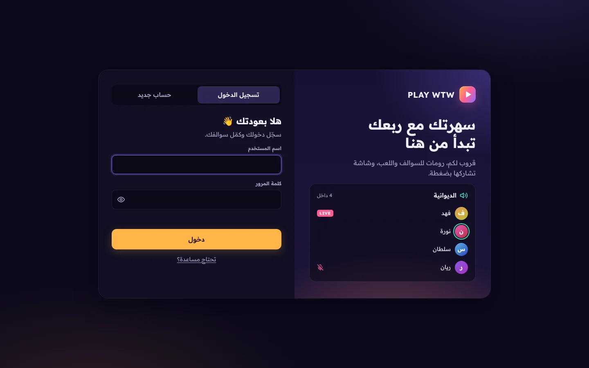

### الجوال
<p>
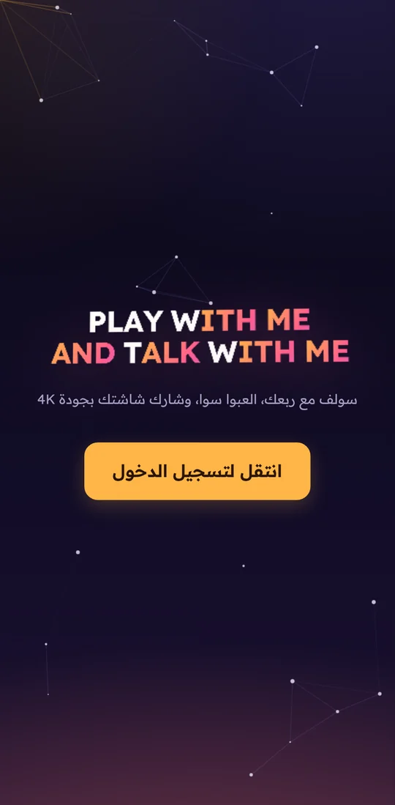
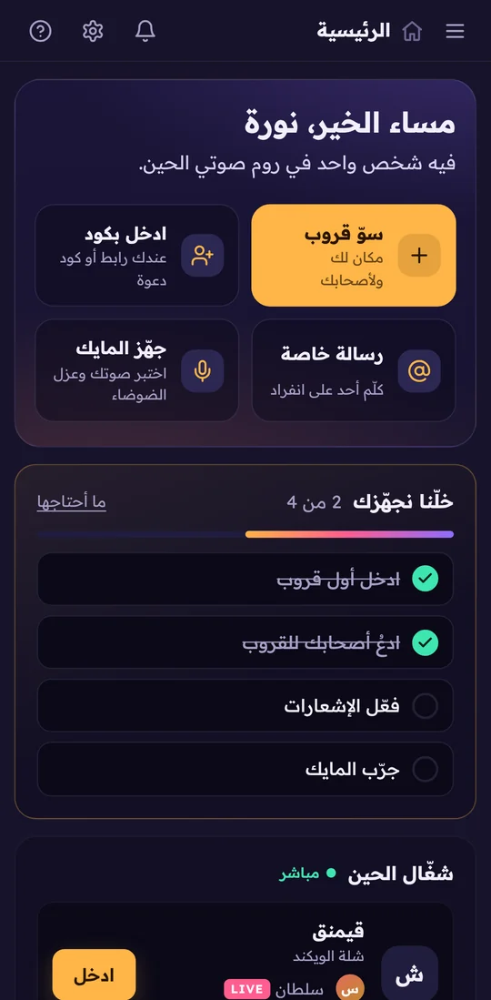
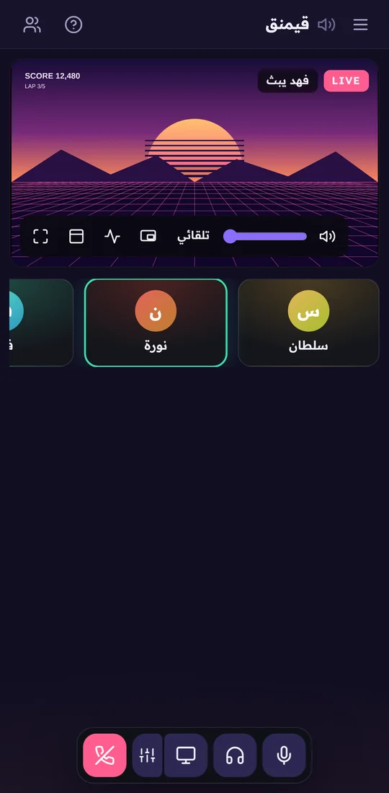
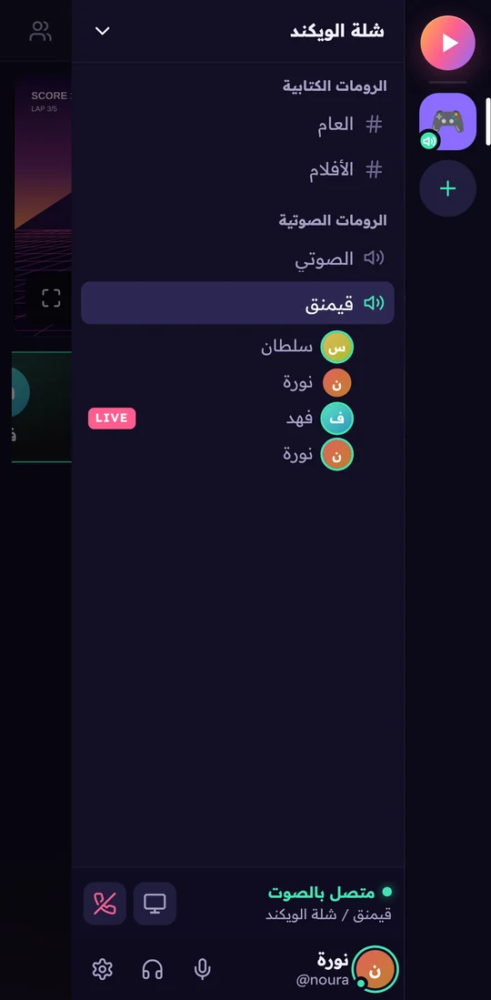
</p>

## المميزات بالتفصيل

**الحساب والإعدادات**
- تسجيل باسم مستخدم وكلمة مرور (مشفّرة بـ PBKDF2)، وتبقى مسجّل 30 يوم
- تغيير كلمة المرور (يطلّعك من باقي الأجهزة)، وحذف الحساب نهائياً
- الاسم ولون الصورة، وحجم الخط، وتقليل الحركة
- أصوات التنبيه، وحجم الخط، وتقليل الحركة

**الشات**
- رسائل خاصة مع أي شخص (من قروباتك أو باسم المستخدم)، بدون قروب
- إرسال صور: تصوّر من الجوال، أو من الألبوم، أو لصق (Ctrl+V)، أو سحب وإفلات. الصور تتصغّر قبل الرفع، وتبان بس للي في نفس الروم أو المحادثة
- قائمة لكل رسالة (⋯ أو ضغط مطوّل في الجوال): نسخ، حذف، بلاغ، حظر
- البلاغات توصل لصاحب الموقع: يحذف الرسالة، أو يحذفها ويطرد صاحبها (وما يقدر يرجع)
- في الخاص: تقدر تحظر الشخص عشان ما يرسل لك

**الإشعارات**
- إشعارات توصل للجوال أو الكمبيوتر **حتى لو الموقع مسكّر** (Web Push)، مشفّرة لجهازك بس
- المنشن: اكتب `@` ويطلع لك أعضاء القروب، واللي تنشنه يوصله إشعار مميز
- لكل قروب: كل الرسايل، أو المنشن بس، أو بدون
- جرس 🔔 فيه المنشنات، ومين دخل قروبك، ومين بدأ يبث
- الموقع ينضاف للشاشة الرئيسية مثل التطبيق (والآيفون يحتاجها عشان الإشعارات)

**الصوت**
- عزل ضوضاء بالذكاء الاصطناعي: قوي (GTCRN) أو خفيف (RNNoise)
- حساسية مايك تلقائية أو يدوية مثل الديسكورد، وزر "اضغط عشان تتكلم"
- اختيار المايك والسماعة، وزر تجربة المايك
- اختصارات: <kbd>M</kbd> المايك، <kbd>D</kbd> كتم الصوت

**البث**
- الدقة من 720p لين 4K، والفريمات من 15 لين 144، مع صوت الجهاز
- إعدادات جاهزة (موفّر، FHD، 2K، 4K، قيمرز)، وتغيير الجودة وانت تبث
- إحصائيات حقيقية للبث (الدقة، الفريمات، السرعة، البنق)
- ملء الشاشة، وتكبير بإصبعين أو بعجلة الماوس، وصورة داخل صورة

**الدعم الفني**
- مركز مساعدة فيه حلول أكثر المشاكل (المايك، الصوت، البث، الجوال)
- للتواصل: [@mj_1o على X](https://x.com/mj_1o)

## كيف يشتغل

```
المتصفح  ⇄  Cloudflare Worker  ⇄  Durable Object (SQLite)
   │          الحسابات والقروبات والرسايل والإشارات
   │
   └──── الصوت والبث مباشر بين الأجهزة (WebRTC) ────┘
         وإذا الشبكة تمنع الاتصال المباشر: عن طريق TURN
```

- **السيرفر:** Cloudflare Worker، والبيانات محفوظة في Durable Object (قاعدة SQLite مدمجة).
- **الصوت والبث:** يروحون مباشرة بين الأجهزة. كل مشاهد ياخذ نسخة لحاله، فسرعة الرفع اللي يحتاجها اللي يبث = البت ريت × عدد المشاهدين.

## الملفات

| المسار | وش فيه |
|---|---|
| `public/index.html` | الصفحة |
| `public/style.css` | التصميم |
| `public/js/main.js` | الواجهة: الحساب، القروبات، الشات، الإعدادات |
| `public/js/voice.js` | الاتصال بين الأجهزة وبث الشاشة |
| `public/js/audio.js` | معالجة المايك وعزل الضوضاء |
| `public/js/intro.js` | الشاشة الافتتاحية |
| `public/js/push.js` | تفعيل إشعارات الجهاز |
| `public/sw.js` | يستقبل الإشعارات والموقع مسكّر |
| `public/manifest.webmanifest` | يخلي الموقع ينضاف للشاشة الرئيسية |
| `public/js/config.js` | بيانات التواصل في الدعم الفني |
| `public/_headers` | رؤوس الأمان للصفحات |
| `public/vendor/nsp/` | مكتبة عزل الضوضاء ([web-noise-suppressor](https://github.com/sapphi-red/web-noise-suppressor)، رخصة MIT) |
| `worker/index.js` | السيرفر |
| `worker/push.js` | تشفير وإرسال إشعارات الجهاز |
| `wrangler.jsonc` | إعدادات Cloudflare |
| `docs/screenshots/` | صور هالصفحة |
| `app/` | تطبيق الآيفون (Capacitor): يفتح الموقع من داخله |
| `.github/workflows/ios.yml` | يبني التطبيق على ماك سحابي ويرفعه على TestFlight |

## التشغيل

الموقع مربوط بـ Cloudflare. كل تعديل ينرفع على `main` ينشر لحاله.

للتجربة على جهازك:
```sh
npx wrangler dev
```


## تطبيق الآيفون (TestFlight)

التطبيق يفتح الموقع من داخله، فأي تحديث للموقع يوصل للتطبيق على طول. البناء الجديد يحتاجه بس لو تغيّر شي في مجلد `app/`، ويصير لحاله على ماك سحابي من GitHub Actions.

**مرة وحدة بس:**
1. اشترك في [Apple Developer Program](https://developer.apple.com/programs/) (99$ بالسنة).
2. في [App Store Connect](https://appstoreconnect.apple.com) ← Apps ← ➕ New App: المنصة iOS، والاسم PLAY WTW، والـ Bundle ID ‏`com.playwtw.app` (لو ما طلع في القائمة، سجّله أول من developer.apple.com ← Identifiers).
3. App Store Connect ← Users and Access ← Integrations ← App Store Connect API ← ➕: سوّ مفتاح بصلاحية **Admin**، ونزّل ملف `.p8` (ينزل مرة وحدة بس).
4. في قيت هب: Settings ← Secrets and variables ← Actions ← New repository secret، وحط أربع أسرار:
   - `APPLE_TEAM_ID`: من developer.apple.com ← Membership
   - `ASC_KEY_ID` و`ASC_ISSUER_ID`: من صفحة المفتاح
   - `ASC_KEY_P8`: افتح ملف `.p8` بأي محرر نصوص وانسخ كل اللي فيه
5. Actions ← iOS → TestFlight ← Run workflow.

بعد 10–30 دقيقة تطلع النسخة في TestFlight. نزّل تطبيق TestFlight من App Store وثبّت منه.

بدون الأسرار، البناء يطلع نسخة بدون توقيع (للتأكد إن كل شي سليم) وما يرفع شي.

## الأمان
- كلمات المرور مشفّرة (PBKDF2 مع salt لكل حساب)، والجلسة في كوكي `HttpOnly` و`Secure` و`SameSite`.
- ما فيه أي مفتاح سري في كود الواجهة. مفاتيح TURN محفوظة كـ Secrets في Cloudflare، والمتصفح ياخذ بيانات دخول مؤقتة بس.
- كل المدخلات تنفحص في السيرفر (الطول، النوع، والرموز المخفية)، وكل النصوص تنعرض كنص عشان ما ينحقن كود (XSS).
- حماية من الطلبات من مواقع ثانية (CSRF): فحص المصدر ونوع الطلب.
- حدود ضد التخمين والسبام: محاولات الدخول، والتسجيل، والرسايل، وأكواد الدعوة.
- رؤوس أمان للصفحات: Content-Security-Policy، ومنع العرض داخل مواقع ثانية، وغيرها (`public/_headers`).
- تغيير كلمة المرور يطلّعك فوراً من باقي الأجهزة. وصور القروب تبان لأعضائه بس.
- إشعارات الجهاز مشفّرة من السيرفر لجهازك مباشرة، ومفتاح التوقيع الخاص محفوظ في السيرفر بس. والسيرفر ما يرسل إلا لخدمات الإشعارات المعروفة (قوقل، أبل، موزيلا، مايكروسوفت).

## ملاحظات
- من الجوال: تقدر تبث **الكاميرا** (الأمامية أو الخلفية، وتقلب بينهم وانت تبث). بث **شاشة** الجوال يشتغل بس لو متصفح الجوال يسمح، والآيفون ما يسمح للمواقع أبداً (يحتاج تطبيق).
- الدقة ما تطلع أعلى من دقة شاشة اللي يبث.
